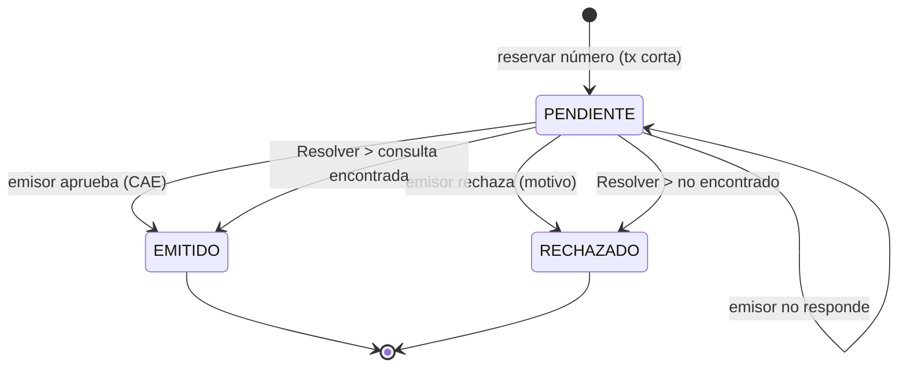

# Facturación (ola 5, etapa 4)

Facturas A, B y C y notas de crédito con **emisor simulado**. Datos: [[Datos - Facturación]]. Integración real: [[Integración ARCA (tarea 5.2)]].

> [!danger] Sin ARCA, nada tiene validez fiscal
> Todo comprobante sale con ambiente `SIMULADO` y la marca **SIN VALIDEZ FISCAL** en pantalla y en la impresión. No sirve ante ARCA ni para entregarlo como factura.

## Qué letra toca

| Emisor | Cliente | Letra |
|---|---|---|
| Responsable inscripto | RI con CUIT | **A** |
| Responsable inscripto | cualquier otro | **B** |
| Monotributista | cualquiera | **C** (no discrimina IVA; avisa si la venta tenía IVA) |

- Un cliente RI, monotributista o exento **necesita CUIT**.
- Documento informado: CUIT → DNI → sin identificar (solo si el total no supera el umbral de identificación, $ 10.000.000 por defecto, a confirmar).

## Estados y numeración

- Numeración por **serie** (ambiente, punto de venta, tipo) con advisory lock: número = último autorizado según el emisor + 1, y debe coincidir con el último EMITIDO de la base.
- Un **RECHAZADO no ocupa el número**: el reintento usa el mismo.
- Con un **PENDIENTE** en la serie no se emite otro; "Resolver" consulta al emisor si tiene más de 2 minutos.

### Emisión en dos fases
1. `reservarFacturaEnTx`: bloquea la venta, valida todo, reserva el número y guarda el PENDIENTE con la foto completa. Se confirma.
2. `emisor.solicitarCae(...)` **fuera** de toda transacción.
3. `registrarResultadoEnTx`: PENDIENTE → EMITIDO o RECHAZADO.

Así un corte nunca deja un número autorizado por ARCA sin rastro en la base. `emitirFacturaEnTx` (una transacción) solo acepta el simulador.

## Importes
Precios con IVA incluido; neto redondeado **por línea** (igual que la venta); alícuotas agrupadas sumando netos e IVA ya redondeados. **Conciliación con tolerancia cero**: si no cierra por un centavo, se rechaza con un mensaje claro. Nunca se ajusta en silencio.

## Pantallas
- **`/ventas/[id]` → panel Facturación**: estado, botón Facturar (`emitirComprobante`, ambos roles), Emitir NC (`emitirNotaCredito`, solo dueño).
- **`/comprobantes`**: más nuevos primero; filtros tipo/estado/ambiente/fechas en la URL (compartibles). Sin costos.
- **`/comprobantes/[id]`**: estado y CAE, emisor, receptor, líneas, IVA por alícuota, venta, "Emitido por".
- **`/comprobantes/[id]/imprimir`**: A4 con **QR fiscal** (SVG, `src/lib/qr-fiscal.ts`) y la marca repetida en cada hoja. PDF: Imprimir → "Guardar como PDF".

## Notas de crédito
Anulan el **total** de una factura emitida; copian la foto de la factura (no la venta actual); misma letra y punto de venta; serie propia. Una NC vigente por factura. Solo dueño.

## Datos fiscales
En `/configuracion` (solo dueño): razón social, CUIT, condición IVA, domicilio, inicio de actividades, IIBB, punto de venta, umbral. Sin los obligatorios no se factura y la venta dice qué falta.

## Variables de entorno

| Variable | Valor | Efecto |
|---|---|---|
| `EMISOR_FISCAL` | `simulado` (defecto) | emisor simulado |
| `EMISOR_FISCAL` | `arca` | reservado: responde "no implementado" |
| `PERMITIR_EMISOR_SIMULADO` | exactamente `1` | con `NODE_ENV=production`, habilita el simulador (demo). Sin ella, facturar queda deshabilitado |

## Qué NO hay
NC parciales, nota de débito, otras monedas, percepciones, concepto servicios, FCE MiPyME, tipos M/E, pasaporte/CDI, exento/no gravado, fecha distinta de hoy, CAEA, envío por mail.

Código: `src/lib/comprobantes.ts`, `src/lib/facturacion.ts`, `src/lib/datos-fiscales.ts`, `src/lib/fiscal/`, `src/lib/dominio/comprobantes.ts`, `notas-credito.ts`.
Pruebas: `test:datos-fiscales`, `test:comprobantes(:db)`, `test:qr`, `test:facturar(:db)`, `test:notas-credito`.
Ver también [[Dudas para el contador]].
