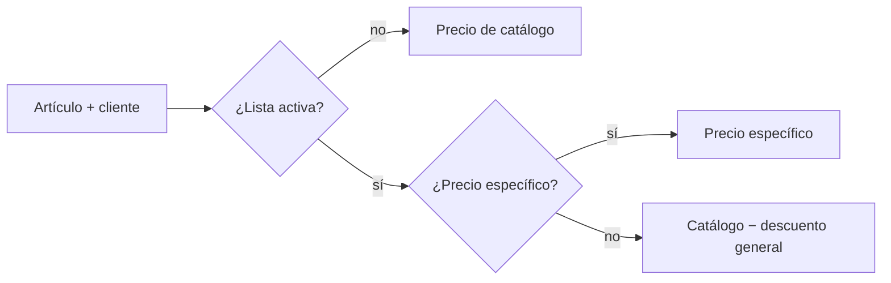

# Listas de precios y presupuestos (ola 7)

Datos: [[Datos - Comercial y cobranza]].

## Listas de precios (`/listas-precios`) — solo dueño

- Descuento general sobre el catálogo y, si hace falta, **precios específicos por artículo**.
- Se asigna a clientes desde su ficha (solo el dueño).
- Dar de baja una lista no la borra: sus clientes vuelven a precio de catálogo hasta que se reactive.
- Advertencia de **precios por debajo del costo** de receta en `/listas-precios/[id]`.
- "Creada por".

### `resolverPrecio` (`src/lib/precios.ts`)

Lo calcula el servidor al confirmar; el navegador solo lo muestra.

## Presupuestos (`/presupuestos`) — dueño y empleado

- Cliente + artículos + cantidades. **Precio de cada línea congelado** al crearlo (o al agregar la línea al editar). Si cambia el cliente al editar, se reprecia todo.
- **Validez**: 15 días por defecto (hasta 365). "Vencido" se calcula; un vencido no se edita ni se convierte: **se duplica** con precios de hoy.
- **Convertir en venta**: crea la venta con los precios congelados en una transacción (pendiente y sin pago); el presupuesto pasa a `CONVERTIDO` con enlace a la venta. Bloqueo `FOR UPDATE` + CHECK: **no se convierte dos veces** aunque lleguen dos pedidos a la vez.
- Vista para imprimir y enlace de WhatsApp (número, total y validez).
- Filtros por estado: abiertos, vencidos, convertidos, anulados.
- No guarda costos ni márgenes; no reserva stock; no registra aceptación.

> [!warning] Límite conocido
> Si cambia el IVA de un artículo entre el presupuesto y la conversión, el total coincide pero el desglose neto/IVA usa el IVA actual (la conversión avisa).

Permisos: `verPresupuestos`, `cargarPresupuesto`, `convertirPresupuesto` (ambos roles); `gestionarListasPrecios` (dueño).

Pruebas: `test:precios(:db)`, `test:presupuestos(:db)`.
