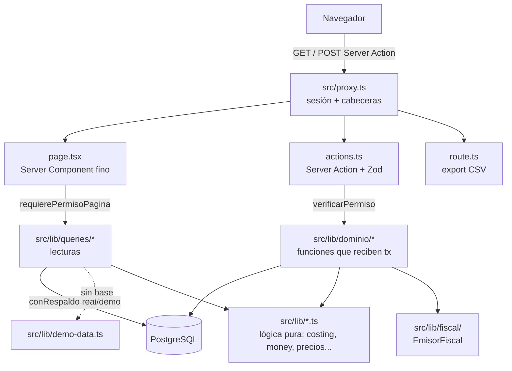

# Arquitectura

## Stack (versiones actuales de `package.json`)

| Tema | Elección | Por qué |
|---|---|---|
| Framework | **Next.js 16.4** (App Router, React Server Components, Server Actions) | Un lenguaje, SSR rápido en el celular, Server Actions eliminan la capa REST |
| UI | **React 19.3** + **Tailwind CSS 4.3**, componentes propios | Diseño simple; sin librería de UI que mantener |
| Lenguaje | **TypeScript 7** estricto | El dominio es dinero: los tipos son la primera defensa |
| Base | **PostgreSQL 17** | Numeración correlativa transaccional, CHECK, triggers, agregaciones |
| ORM | **Prisma 7.10** con `@prisma/adapter-pg` | Migraciones versionadas, tipos derivados, seed |
| Dinero | `Decimal` de Prisma + `decimal.js` | **Nunca `float`** |
| Validación | **Zod 4.6** | Un schema por formulario |
| QR | `qrcode` | QR fiscal en SVG del lado del servidor |
| Node | ≥ 20 | |

> [!important] Next.js 16
> `AGENTS.md` advierte que esta versión de Next tiene cambios incompatibles con lo conocido: leer `node_modules/next/dist/docs/` antes de escribir código. En Next 16 el **proxy** (`src/proxy.ts`, ex middleware) corre en Node.js y puede consultar la base.

## Por qué así

- **Barato de operar.** Un VPS chico con un solo proceso hace posible ofrecerlo a un comercio pequeño. Serverless, microservicios o multi-región multiplican costo sin aportar nada.
- **Postgres y no SQLite**: (1) numeración correlativa atómica con locks; (2) `CHECK` como última línea de defensa; (3) reportes con `GROUP BY` y window functions.
- **Costo congelado** en la venta para que un cambio de precio no reescriba la historia. Ver [[Reglas del proyecto]].

## Capas



1. **`src/proxy.ts`** — verifica la sesión en cada pedido (páginas, RSC, server actions, route handlers) y agrega cabeceras de seguridad.
2. **Páginas (`page.tsx`)** — finas: primera línea `requierePermisoPagina(...)`, piden datos a `queries/` y renderizan.
3. **Server Actions (`src/app/**/actions.ts`)** — primera sentencia `verificarPermiso(...)`, validan con Zod y delegan en `dominio/`. **Recalculan todo en el servidor**: el navegador solo informa qué, cuánto y a quién.
4. **`src/lib/dominio/`** — reglas de negocio con escritura; reciben un `tx` de Prisma para poder probarse sin Next (`npm run test:acciones`).
5. **`src/lib/queries/`** — lecturas, envueltas en `conRespaldo(real, demo)`.
6. **`src/lib/*.ts` puros** — motor de costeo, dinero, precios, fechas, CSV, CUIT, QR... cada uno con `scripts/verificar-*.ts`.
7. **Base** — `CHECK`, índices parciales y triggers en `prisma/migrations/`.

## Estructura de carpetas

```
ventas/
├── docs/                    documentación original del repo
├── prisma/
│   ├── schema.prisma        fuente de verdad del modelo
│   ├── migrations/          SQL con CHECK, índices parciales y triggers
│   └── seed.ts              comercio de ejemplo
├── scripts/                 pruebas (verificar-*, test-*), respaldos, crear-dueno
├── public/marca/            logo e íconos
├── src/
│   ├── proxy.ts             autenticación en cada pedido
│   ├── app/                 rutas (una carpeta por pantalla; _componentes/ y actions.ts adentro)
│   ├── components/          compartidos: navbar, tablero, ui, form/, formularios de venta y compra
│   ├── generated/           cliente Prisma generado
│   └── lib/
│       ├── costing.ts       motor de costeo (puro)
│       ├── money.ts         aritmética decimal y formato es-AR
│       ├── precios.ts       resolverPrecio
│       ├── auth*.ts, permisos*.ts
│       ├── acciones.ts      Resultado, SIN_BASE, decimales con coma, hoy en Argentina
│       ├── demo-data.ts     datos del modo demo
│       ├── dominio/         17 módulos de escritura (ventas, pagos, stock, comprobantes...)
│       ├── queries/         19 módulos de lectura
│       └── fiscal/          emisor.ts (interfaz), emisor-simulado.ts, index.ts
└── docker-compose.yml       db + backup
```

## Archivos compartidos

`prisma/schema.prisma`, `src/components/navbar.tsx`, `src/lib/demo-data.ts`, `README.md`, `package.json`: solo se editan cuando la tarea lo dice (regla de las olas, ver [[Historial por olas]]).

## Modo demo

Si Postgres no responde (o una consulta falla, p. ej. migraciones pendientes), cada pantalla cae a `src/lib/demo-data.ts`. No son números a mano: salen del mismo motor de costeo, así que las pantallas son coherentes. Se entra como un dueño simulado "Demo" (solo en desarrollo) y las acciones devuelven `SIN_BASE`. En producción sin base: **503**.

Relacionado: [[Reglas del proyecto]], [[Modelo de datos]], [[Seguridad y permisos]].
