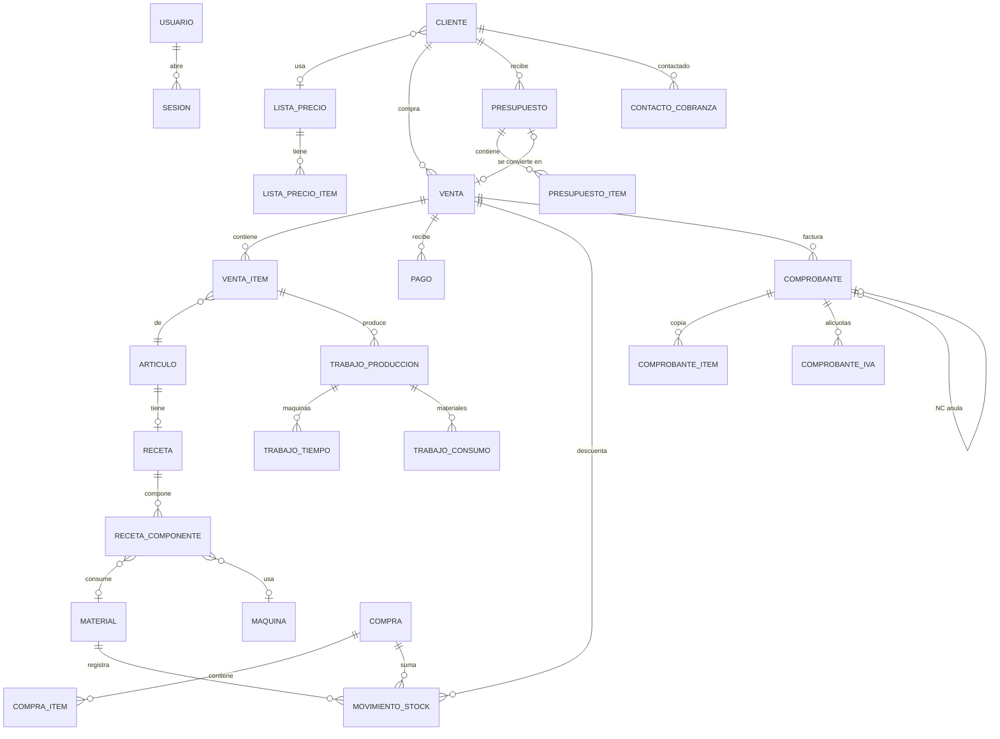

# Modelo de datos

Fuente de verdad: `prisma/schema.prisma`. Lo que Prisma no expresa (`CHECK`, índices únicos parciales, triggers) está en `prisma/migrations/`. Detalle por grupo:

- [[Datos - Usuarios y sesiones]]
- [[Datos - Clientes]]
- [[Datos - Catálogo y costos]]
- [[Datos - Ventas y cobros]]
- [[Datos - Compras y stock]]
- [[Datos - Comercial y cobranza]]
- [[Datos - Facturación]]
- [[Datos - Producción]]

## Ideas de diseño

1. **Nada de saldos almacenados** (saldos, estado de pago, vencimiento, antigüedad: todo calculado).
2. **El costo se congela en la venta.**
3. **Los precios se congelan donde se usan** (`VentaItem`, `PresupuestoItem`).
4. **Un solo catálogo de materiales** para insumo y reventa.
5. **El costo de un artículo sale de su receta.**
6. **Baja lógica** en clientes, artículos, materiales, usuarios y listas de precios.
7. **Quién hizo qué**: `usuarioId` nullable, FK `RESTRICT` (lo histórico queda en `NULL` → "—").
8. **El comprobante es una foto.**

## Mapa de tablas

| Grupo | Tablas |
|---|---|
| Usuarios y acceso | `usuarios`, `sesiones` (enum `Rol`) |
| Clientes | `clientes` |
| Catálogo y costos | `articulos`, `recetas`, `receta_componentes`, `materiales`, `maquinas`, `configuracion` |
| Ventas y cobros | `ventas`, `venta_items`, `pagos` |
| Compras y stock | `compras`, `compra_items`, `movimientos_stock` |
| Comercial | `listas_precios`, `lista_precio_items`, `presupuestos`, `presupuesto_items` |
| Cobranza | `contactos_cobranza` |
| Facturación | `comprobantes`, `comprobante_items`, `comprobante_iva` |
| Producción | `trabajos_produccion`, `trabajo_tiempos`, `trabajo_consumos` |

## Diagrama de relaciones (simplificado)



## Trazabilidad (`usuarioId`)

| Tabla | Quién queda registrado |
|---|---|
| `ventas` | quien cargó la venta |
| `pagos` | quien registró el cobro |
| `compras` | quien cargó la compra |
| `movimientos_stock` | quien hizo el movimiento o la operación que lo generó |
| `presupuestos` | quien lo creó (el duplicado, quien duplica) |
| `contactos_cobranza` | quien registró el contacto |
| `listas_precios` | quien la creó |
| `comprobantes` | quien emitió |
| `trabajos_produccion` | quien cargó el trabajo |

## Cálculos derivados (no se persisten)

```
saldo_venta   = venta.totalBruto − Σ pagos no anulados
saldo_cliente = Σ saldo_venta sobre ventas no anuladas
precio_linea  = resolverPrecio: específico → catálogo − descuento → catálogo
valido_hasta  = presupuesto.fecha + validezDias
vencido       = estado = ABIERTO AND hoy > valido_hasta
costo_real    = Σ cant × costoSnapshot + Σ min/60 × costoHoraSnapshot + minMO/60 × costoHoraMOSnapshot
desvio        = costo_real − costo de receta de la línea
situacion_facturacion = VENTA_ANULADA | SIN_FACTURA | PENDIENTE | RECHAZADA | EMITIDA | CON_NOTA_CREDITO
```

## Migraciones (orden lógico)

| # | Migración | Contenido |
|---|---|---|
| 1 | `20260101000000_init` | Clientes, materiales, máquinas, artículos, recetas, ventas, pagos, configuración; CUIT único parcial; primeros CHECK |
| 2 | `20260102000000_stock_real` | Compras, líneas, movimientos de stock |
| 3 | `20260103000000_movimientos_de_venta` | `movimientos_stock.ventaId` para revertir exacto |
| 4 | `20260130010000_pagos_anulables` | Baja lógica de pagos |
| 5 | `20260210000000_usuarios_y_sesiones` | `Rol`, `usuarios`, `sesiones` |
| 6 | `20260215000000_trazabilidad_usuario` | `usuarioId` en ventas, pagos, compras, movimientos |
| 7 | `20260301000000_comprobantes` | Facturación completa: enums, tablas, CHECK, índices parciales, triggers; `clientes.condicionIva`, `dni` |
| 8 | `20260401000000_produccion` | Producción (ola 6) |
| 9 | `20260501000000_listas_precios` | Listas de precios |
| 10 | `20260510000000_presupuestos` | Presupuestos |
| 11 | `20260515000000_contactos_cobranza` | Contactos de cobranza |
| 12 | `20260520000000_trazabilidad_ola7` | `usuarioId` en presupuestos, contactos y listas |

Prisma las aplica por timestamp (las de ola 5 y 6 van antes que las de ola 7 aunque se hicieron después).
