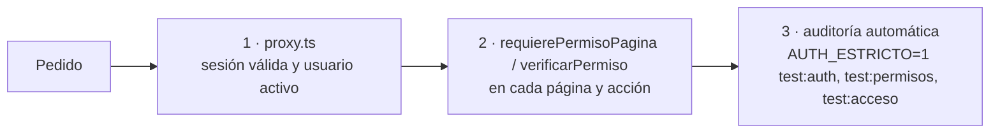

# Seguridad y permisos

Código: `src/lib/auth-pura.ts` (puro), `src/lib/dominio/auth.ts` (núcleo con base), `src/lib/auth.ts` (capa Next), `src/lib/permisos-pura.ts`, `src/lib/permisos.ts`, `src/proxy.ts`, `src/app/login/`. Funcional: [[Usuarios y acceso]].

## Claves
- **scrypt** (`node:crypto`), N = 2^15, r = 8, p = 3 (OWASP), sal de 16 bytes, hash de 64 bytes, ~0,3 s.
- Formato autodescriptivo `scrypt$ln=15,r=8,p=3$<sal>$<hash>`: si se suben parámetros, se **rehashea solo** en el siguiente login. Parámetros acotados al leer.
- `timingSafeEqual`; longitud 10–200 caracteres; normalización **NFC**.

## Login
- **Mensaje único** para usuario inexistente, clave incorrecta, baja o pausa.
- **Tiempo parejo**: siempre se calcula scrypt (contra un hash falso si no hay usuario).
- **Pausa creciente por usuario, en la base**: 4 fallos libres; luego 30 s → 15 min tope. Nunca bloqueo permanente.
- **Intentos en paralelo**: compare-and-swap antes de verificar; de 10 simultáneos solo 1 se verifica.
- Cada login estrena token (sin fijación de sesión). `?siguiente=` solo a rutas internas validadas.

## Sesión y cookie
- Token de 32 bytes; la base guarda solo su **SHA-256**.
- Cookie `httpOnly`, `sameSite=lax`, `Secure` en producción, nombre `__Host-ventas_sesion`.
- 30 días con **renovación deslizante** (máx. 1 escritura por día, la hace el proxy).
- Vencimiento verificado en servidor contra `expiraEn`.

## Tres capas de verificación

1. **`src/proxy.ts`** (Next 16, corre en Node y consulta la base). `matcher` cubre todo salvo `/_next/static/`, manifiesto, íconos y `public/marca/`. Sin sesión: GET → 307 a `/login?siguiente=…`; server action → 401 con `x-action-redirect`; otro método → 303.
2. **En el código**: páginas con `await requierePermisoPagina(...)` primero (sin permiso → inicio del rol); acciones con `verificarPermiso(...)` como **primera sentencia**; route handlers con `usuarioActual()` + `puede()` → 401/403. **El layout raíz no protege.**
3. **Auditoría**: `AUTH_ESTRICTO=1 npm run test:auth` lee el código y exige las llamadas; `test:permisos` prueba la matriz e invoca acciones prohibidas con un empleado real; `test:acceso` hace todo por HTTP contra `next build && next start` y verifica que el HTML/RSC del empleado no traiga costos ni márgenes.

## Matriz de permisos (`src/lib/permisos-pura.ts`)

Regla de oro: **lo que no está en la tabla, no se puede**. `DUENO` puede todo lo de la tabla; `EMPLEADO` solo lo nombrado. Acción desconocida: nadie.

| Solo `DUENO` | `DUENO` y `EMPLEADO` |
|---|---|
| `verCostos`, `verMargenes` | `verVentas`, `cargarVenta` |
| `anularVenta`, `anularPago` | `registrarCobro`, `marcarEntregada` |
| `ajustarStock`, `registrarCompra` | `verCobranzas`, `verClientes`, `editarClientes` |
| `editarCatalogo`, `editarMateriales` | `verStock` (cantidades), `verReposicion` (sin costos) |
| `verReportes`, `exportarCsv` | `cambiarClavePropia` |
| `configuracion`, `gestionarUsuarios` | `verPresupuestos`, `cargarPresupuesto`, `convertirPresupuesto` |
| `gestionarListasPrecios` | `verRecordatorios`, `registrarContactoCobranza` |
| `emitirNotaCredito` | `verComprobantes`, `emitirComprobante` |
| `verMargenReal` | `cargarProduccion` |

## CSRF y cabeceras
- Server actions solo por POST y Next compara `Origin` con `Host`; cookie `sameSite=lax`. Detrás de un proxy que cambie el Host: `serverActions.allowedOrigins`, nunca desactivar.
- Logout por POST. GET sin efectos (salvo renovar la propia sesión).
- `X-Frame-Options: DENY`, CSP `frame-ancestors 'none'`, `nosniff`, `Referrer-Policy: same-origin`.
- Al navbar (cliente) solo llega `{ nombre, rol }`.
- `images.unoptimized` (no se usa `next/image`): menos superficie.

## Fuera de alcance
- **Límite por IP**: recomendado `limit_req` de nginx (o Caddy/Cloudflare) sobre `POST /login`.
- Un atacante puede mantener en pausa al dueño (no cierra sesiones abiertas). Mitigación futura: cookie de dispositivo conocido.
- 2FA, recuperación de clave, listado/cierre remoto de sesiones, auditoría de logins, limpieza programada de sesiones, CSP completa.
